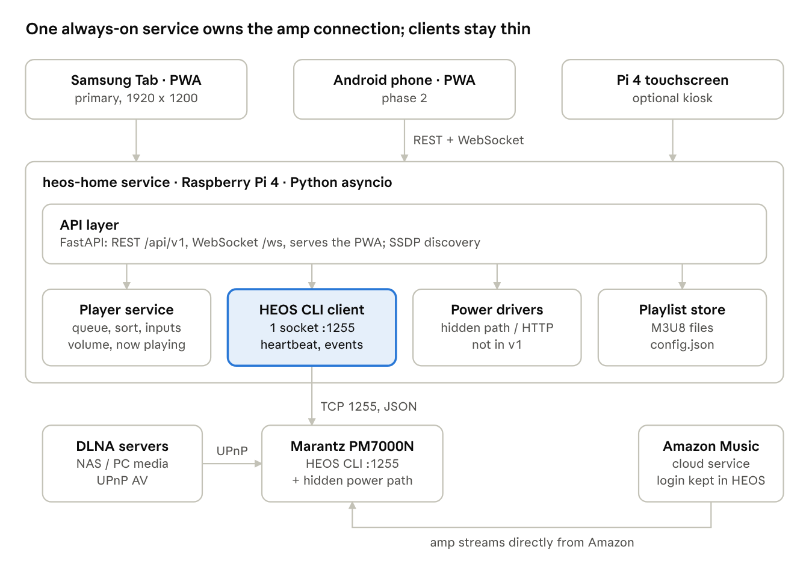
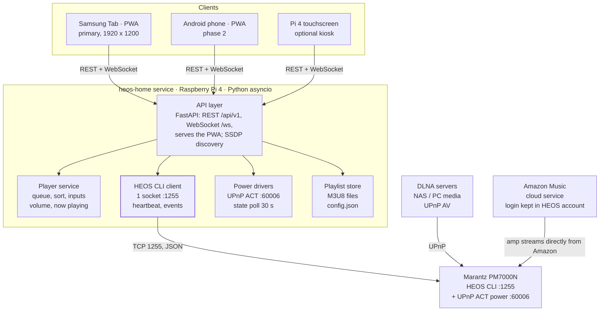

# HEOS Home Controller – Specification

Nov 20, 2026 · Denis

## 1. Goal and scope

This is a local-only controller for the HEOS devices at home. It replaces the unreliable Denon HEOS app for daily use: discovery, power, input and volume, queue and playlist management, DLNA browsing and Amazon Music. Nothing depends on Denon's cloud for control.

**Devices in scope**

- Marantz PM7000N (primary target)
- Any other HEOS device found on the LAN (same CLI, port 1255)

**Clients**

| Phase | Client | Viewport | Notes |
| --- | --- | --- | --- |
| 1 | Samsung Android tablet | 1920 x 1200, landscape | Primary, wall or couch use |
| 2 | Android smartphone | ~412 x 915 dp, portrait | Same web app, responsive layout |
| optional | Raspberry Pi 4 touchscreen | 800 x 480 | Kiosk mode, Chromium |

**Out of scope for v1**

- Initial Wi-Fi onboarding and firmware installation: done on the amp's front panel (see F8.5)
- Multi-room grouping UI (the API supports it; it can come later)
- Not planned: LAN-only by design (no access from outside the home network)
- Streaming services other than Amazon Music (the only one in use today); the source layer stays generic so a lossless service can be added later (F6.5)

## 2. Architecture overview

The system is a local service on the home network with a web client (PWA). All logic and state live in the service; the clients only display and send commands.

- **Service:** `heos-home` on the Raspberry Pi 4. It owns the single HEOS CLI connection, receives all change events, runs discovery and power control, and stores settings in JSON files and playlists as M3U8 files (section 5).
- **Clients:** the Samsung tablet and the phone run the same PWA in the browser, installed to the home screen. They hold no state and talk only to the service, over REST + WebSocket.
- **Integrations:** the same API can later feed MCP, MQTT or Home Assistant.
- **Availability:** the service runs under systemd with `Restart=always` on the always-on Pi; clients show an offline banner and reconnect when it comes back.
- **Native wrapper (optional, later):** a TWA or Capacitor shell around the PWA, if a launcher icon or kiosk features are needed.

Components, ports and data flow are in section 3.

## 3. System architecture

One Python service on the Pi 4 holds the only HEOS connection, stores all state, and serves the web UI. Clients only talk to that service.



Same diagram as Mermaid (renders on GitHub, GitLab, Obsidian, VS Code):



The amp fetches media itself, from DLNA servers and from Amazon using the Amazon login stored in the HEOS account. The service only tells it what to play, so audio never passes through the Pi.

| Link | Protocol | Port |
| --- | --- | --- |
| Client to service | HTTP REST + WebSocket | 8080 (LAN) |
| Service to HEOS device | HEOS CLI, ASCII + `\r\n`, JSON responses | TCP 1255 |
| Discovery | SSDP M-SEARCH | UDP 1900 multicast |
| Power on/off and power state | UPnP SOAP, ACT service (`GetDevicePowerState` / `SetDevicePowerState`) | TCP 60006 |

## 4. Functional requirements

Priority: **M** = must (v1), **S** = should (v1 if time allows), **C** = could (later).

### F1. Device discovery

| ID | Requirement | Pri |
| --- | --- | --- |
| F1.1 | Discover HEOS devices by SSDP M-SEARCH, `ST: urn:schemas-denon-com:device:ACT-Denon:1`, at service startup | M |
| F1.2 | Allow a manual IP per device as an override (for when multicast fails) | M |
| F1.3 | Hold one CLI connection to one device; `player/get_players` returns all players and their `pid` | M |
| F1.4 | Show a device list: name, model, IP, firmware, online/offline, network (wired/wifi) | M |
| F1.5 | Re-discover on request: a "Re-discover" button on the Devices screen (`POST /devices/discover`), used after a device IP change or reboot | S |

### F2. Power on/off

| ID | Requirement | Pri |
| --- | --- | --- |
| F2.1 | Power on and to standby through the UPnP ACT service the HEOS app uses (`SetDevicePowerState` ON/OFF, port 60006; verified on PM7000N, see section 9). Gentle: a request for the current state does nothing, and switches are at least 10 s apart | M |
| F2.3 | Wake by starting playback / `play_input` when the amp is in network standby | S |
| F2.4 | Show power state (`on` / `standby` / `unknown`) from `GetDevicePowerState`: read at connect, polled every 30 s, re-read when a HEOS volume event hints at a change. The HEOS CLI itself answers in standby, so CLI reachability is not power state | M |
| F2.5 | Pluggable power driver per device: `auto` (default: `upnp_act` if the device answers it), `upnp_act`, `none`. Telnet port 23 (`PW?`, `PWON`, `PWSTANDBY`) is a possible fallback driver | S |

### F3. Player and queue

| ID | Requirement | Pri |
| --- | --- | --- |
| F3.1 | Transport: play, pause, stop, next, previous; shuffle and repeat | M |
| F3.2 | Volume slider 0–100, step up/down, mute | M |
| F3.3 | Input select: phono, CD, line, optical 1/2, coax; list read from the device, not hard-coded | M |
| F3.4 | Now playing: title, artist, album, cover art, source, progress bar (from `player_now_playing_progress` events) | M |
| F3.5 | Show the current HEOS queue; remove items; move items (`player/move_queue_item`); clear | M |
| F3.6 | Add items from any source to the queue: play now, play next, add to end, replace and play (`add_to_queue` aid 1–4) | M |
| F3.7 | Sort the queue by rule: title, artist, album, random; ascending/descending; ties keep their current order (album tracks stay in sequence). Runs on the server as single-item `move_queue_item` calls, moving only items outside the longest already-ordered run. Track number, duration and date added are not possible: `get_queue` does not report them, and clear + re-add is not possible because queue items carry no source id | M |
| F3.8 | Multi-select in the queue for bulk remove/move | S |

### F4. Local playlists

| ID | Requirement | Pri |
| --- | --- | --- |
| F4.1 | Save the current queue as a named local playlist, stored on the server | M |
| F4.2 | List, rename, duplicate, delete local playlists | M |
| F4.3 | Load a playlist: replace queue, or append | M |
| F4.4 | Edit a playlist without playing it: add, remove, reorder, sort by rule | S |
| F4.5 | Import / export: playlists are already .m3u8 files; download or upload them from the UI | S |
| F4.6 | Mark items that cannot be resolved any more (DLNA file gone, streaming ID expired); offer re-match by title/artist search | S |
| F4.7 | Optionally also save to HEOS (`player/save_queue`) | C |

### F5. DLNA / UPnP media servers

| ID | Requirement | Pri |
| --- | --- | --- |
| F5.1 | List DLNA servers the HEOS device sees (`browse/browse?sid=1024`, "Local Music", lists each server with its own sid) | M |
| F5.2 | Browse containers page by page (`browse/browse` with `range`), breadcrumb navigation | M |
| F5.3 | Play or queue a single track (`cid` + `mid`), a folder, or a whole container (`add_to_queue` with `cid`). A folder holding tracks is listed as `playable: no` by its parent, but browsing it returns option 21 "Playable Container"; that option decides whether "Play all" is offered | M |
| F5.4 | Search within a server, where the server supports it (`browse/search`). The NAS in use answers every search with eid 12, so the UI falls back to filtering the loaded folder | S |
| F5.5 | Server-side cache of browse results (TTL 10 min) to make the UI fast | S |
| F5.6 | Recursive add of a folder tree (server walks it, queues in batches) | C |
| F5.7 | Folder shortcuts: pin favourite folders per server, and reopen at the last browsed folder | S |

Navigation is folder-based, through the standard DLNA browse the HEOS CLI exposes. The music is already organized by folder on the server, so no server-specific tag indexing is needed. On the NAS in use the path is server → Music → Folder → share (e.g. `music`) → folders; Music also offers the server's own views (Songs, Artist, Album, Genre, …), which stay browsable. Pages take 30–110 ms on the PM7000N.

### F6. External services: Amazon Music

| ID | Requirement | Pri |
| --- | --- | --- |
| F6.1 | Amazon Music, played by the HEOS device. The Amazon login is entered once in the official app and stored in the HEOS account (its "keychain" of service logins); the device must be signed in to that HEOS account (F7). Our app never handles Amazon credentials | M |
| F6.2 | Browse what the CLI exposes for Amazon: playlists, stations, My Music; search | M |
| F6.3 | Play and queue Amazon items like DLNA items | M |
| F6.4 | HEOS Favorites: list, play | S |
| F6.5 | Generic source layer: any HEOS service is a `sid` with browse/search/queue, so adding a second service is configuration, not new code | M |
| F6.6 | Candidate lossless service for classical, not chosen yet. HEOS supports Qobuz natively and through Qobuz Connect (since 2025), plus TIDAL and Deezer | C |

Amazon is only available through the HEOS device's own integration; the app never talks to Amazon directly. Which browse/search operations work for Amazon through the CLI is unverified, see section 9.

### F7. HEOS account

| ID | Requirement | Pri |
| --- | --- | --- |
| F7.1 | Show sign-in state (`system/check_account`) | M |
| F7.2 | Sign in / out (`system/sign_in`, `system/sign_out`); credentials stored encrypted on the server, never in the browser | M |
| F7.3 | Re-sign-in automatically after a device reboot | S |

### F8. Device settings and information

The HEOS CLI only reads device information. Network settings live in the amp itself: in its front-panel Setup menu, and in the settings page the official app shows. That page looks like the amp's own web UI, served by the device and embedded by the app.

| ID | Requirement | Pri |
| --- | --- | --- |
| F8.1 | Device info page: name, model, firmware version, IP, network (wired/wifi), serial, from `player/get_player_info` | M |
| F8.2 | Firmware: show the installed version; check for an update (`player/check_update`, if this model supports it); show how to install it from the front panel (Setup → General → Firmware) | S |
| F8.3 | Native settings page: open the amp's own settings UI (the one the HEOS app embeds) inside our app, through a reverse proxy in the service (handles self-signed HTTPS and frame blocking). URL to be captured in phase 0 | S |
| F8.4 | Rebuild the most used native settings in our UI, if the page's HTTP endpoints are usable: Network Control, Auto-Standby, Friendly Name, network information | C |
| F8.5 | Help panel for front-panel-only tasks: Wi-Fi join (Wi-Fi scan, WPS, Apple WAC), DHCP/static IP, network reset | S |

Recommended network setup: wired Ethernet, DHCP reservation on the router, Network Control = On.

## 5. Data model and storage

There is no database. Settings live in JSON files and each playlist is its own M3U8 file, so everything can be read, edited, backed up and copied with ordinary tools.

```text
/var/lib/heos-home/
├── config.json      # devices, power drivers, settings, folder shortcuts
├── state.json       # last browsed folder per server, last used device
├── secrets.json     # HEOS credentials, encrypted, mode 600
└── playlists/
    ├── evening-jazz.m3u8
    └── bach-cantatas.m3u8
```

**config.json**

```json
{
  "version": 2,
  "default_pid": -1234,
  "devices": [
    {"pid": -1234, "name": "Living room", "model": "Marantz PM7000N",
     "ip": "192.168.1.50", "ip_override": null,
     "power": {"driver": "auto", "config": {}}}
  ],
  "folder_shortcuts": [
    {"name": "Classical", "sid": 1, "cid": "64$1$3"}
  ],
  "ui": {"theme": "dark"}
}
```

**Playlist format: extended M3U8 (UTF-8)**, one file per playlist:

```text
#EXTM3U
#PLAYLIST:Bach Cantatas
#EXTINF:1325,J.S. Bach - Cantata BWV 140: I. Chorus
#EXTALB:Cantatas Vol. 1
#EXTHEOS:{"sid":1,"cid":"64$1$3","mid":"64$1$3$7","track":1}
heos://1/64%241%243/64%241%243%247
```

- `#EXTINF` / `#EXTALB` / `#PLAYLIST` are standard extended-M3U tags, so any text editor or M3U tool shows the list correctly.
- `#EXTHEOS` holds the HEOS IDs needed to queue the item; other tools ignore unknown `#` lines.
- The location line is a `heos://` URI. The HEOS CLI does not expose the DLNA file path or URL, so other players can read the list but cannot play it directly.
- Title, artist, album and duration are stored with each item, so an item whose ID no longer resolves can still be shown and re-matched (F4.6).

**Rules**

- File name = slug of the playlist name; the display name comes from `#PLAYLIST`. Rename = rewrite the tag + rename the file.
- Every write is atomic: write a temp file, fsync, rename. The service is the only writer while it runs.
- The service scans `playlists/` at startup and on request, so files copied in by hand appear in the app.
- Backup = copy the whole `/var/lib/heos-home/` folder.

## 6. Backend API

REST handles commands and queries, and one WebSocket pushes state. Base path `/api/v1`, JSON, OpenAPI generated by FastAPI at `/docs`.

| Method | Path | Purpose | Req |
| --- | --- | --- | --- |
| GET | `/devices` | List devices + state | F1.4 |
| POST | `/devices/discover` | Force rediscovery | F1.1, F1.5 |
| PATCH | `/devices/{pid}` | IP override, power driver config | F1.2, F2.5 |
| GET | `/devices/{pid}/power` | Read power state now ("Test power") | F2.4 |
| POST | `/devices/{pid}/power` | `{"state":"on"\|"off"}`; 429 if switched < 10 s ago | F2.1 |
| GET | `/players/{pid}/state` | Play state, volume, mute, input, now playing | F3 |
| POST | `/players/{pid}/transport` | `{"action":"play\|pause\|stop\|next\|prev"}` | F3.1 |
| PUT | `/players/{pid}/volume` | `{"level":0-100}` or `{"step":±n}` | F3.2 |
| PUT | `/players/{pid}/mute` | `{"state":true}` | F3.2 |
| PUT | `/players/{pid}/play-mode` | `{"shuffle":…,"repeat":…}` | F3.1 |
| GET | `/players/{pid}/inputs` | Available inputs | F3.3 |
| PUT | `/players/{pid}/input` | `{"input":"inputs/phono"}` | F3.3 |
| GET | `/players/{pid}/queue` | Current queue | F3.5 |
| POST | `/players/{pid}/queue` | Add items `{"items":[…],"mode":"now\|next\|end\|replace"}` | F3.6 |
| DELETE | `/players/{pid}/queue` | Remove `{"qids":[…]}` or clear all | F3.5 |
| POST | `/players/{pid}/queue/move` | `{"qids":[…],"to":n}` | F3.5 |
| POST | `/players/{pid}/queue/sort` | `{"by":"title\|artist\|album\|random","order":"asc\|desc"}`; progress as `queue_sort` events | F3.7 |
| GET | `/sources` | Music sources incl. DLNA servers, Amazon | F5.1, F6 |
| GET | `/library/servers` | DLNA servers | F5.1 |
| GET | `/sources/{sid}/browse?cid=&start=&count=&refresh=` | Browse a container; `playable` = the container can be queued whole | F5.2, F5.5 |
| GET | `/sources/{sid}/search?q=&criteria=` | Search; 501 if the server does not support it | F5.4, F6.2 |
| GET | `/sources/{sid}/search-criteria` | Search criteria (scid) | F5.4 |
| GET/POST/DELETE | `/library/shortcuts[/{id}]` | Pinned folders | F5.7 |
| GET/PUT | `/library/last-folder/{sid}` | Last browsed folder per server | F5.7 |
| GET/POST | `/playlists` | List / create (incl. from current queue) | F4.1–F4.2 |
| GET/PATCH/DELETE | `/playlists/{id}` | Read, rename, edit items, delete | F4.2, F4.4 |
| POST | `/playlists/{id}/load` | `{"pid":…,"mode":"replace\|append"}` | F4.3 |
| GET | `/playlists/{id}/export` | Download the .m3u8 file | F4.5 |
| GET/POST | `/account` | Status, sign in/out | F7 |
| GET | `/health` | Liveness + CLI connection state | NFR |

Device settings endpoints (F8):

| Method | Path | Purpose | Req |
| --- | --- | --- | --- |
| GET | `/devices/{pid}/info` | Model, firmware, IP, network, serial | F8.1 |
| GET | `/devices/{pid}/firmware` | Installed version + update available | F8.2 |
| GET | `/devices/{pid}/native/*` | Reverse proxy to the amp's own settings page | F8.3 |
| GET/PATCH | `/devices/{pid}/settings` | Rebuilt native settings (if the endpoints are usable) | F8.4 |

**WebSocket `/api/v1/ws`** pushes typed events. Clients never poll:

```json
{"type":"player_state",   "pid":-1234, "data":{"state":"play"}}
{"type":"volume",         "pid":-1234, "data":{"level":28,"mute":false}}
{"type":"now_playing",    "pid":-1234, "data":{"song":"…","artist":"…","image_url":"…"}}
{"type":"progress",       "pid":-1234, "data":{"cur_pos":81000,"duration":240000}}
{"type":"queue_changed",  "pid":-1234}
{"type":"power",          "pid":-1234, "data":{"state":"standby"}}
{"type":"device_online" | "device_offline", "pid":-1234}
```

The events map one-to-one to HEOS change events (`event/player_state_changed`, `event/player_volume_changed`, `event/player_now_playing_changed`, `event/player_now_playing_progress`, `event/player_queue_changed`, `event/players_changed`).

## 7. UI / UX

The primary layout is tablet landscape (1920 x 1200 px, about 1280 x 800 dp at the Tab's density). It is a navigation rail plus one view at a time. Playback is a view of its own ("Playing"), not a permanent panel, so every other screen gets the full width and the same structure works on a phone. Style: Material 3 (Android-native look), dark theme default, light optional, large touch targets (min 48 dp).

**Tablet layout (landscape)**

| Pane | Width | Content |
| --- | --- | --- |
| Left rail | 80 dp | Device switcher (each device listed with its own power button and state), nav icons: Playing, Library, Playlists, Inputs, Devices, Settings |
| Main | flexible | Current view. Playing: now playing (cover, title, transport, progress, volume) beside the queue on wide screens, above it on narrow ones. Others: browse (DLNA / Amazon / Favorites), playlist editor, inputs grid, devices, settings |

**Screens**

1. **Playing** (nav item, start screen; now playing beside the queue): large cover art, transport, a seek bar that only displays progress (HEOS has no seek command), volume slider + mute, shuffle/repeat. The queue below supports drag to reorder, swipe to remove, a sort menu and "Save as playlist".
2. **Library / Browse:** source tiles (each DLNA server, Amazon Music, HEOS Favorites), then a list of containers with a breadcrumb. Selecting never plays anything by itself: tapping a track selects it, tapping a folder opens it, and a folder's radio selects the folder. An action bar applies to the selected item, or to the whole open folder when nothing is selected: **Add and play**, **Replace queue and play**, **Add to end of queue** (later also Add to playlist…).
3. **Search:** one box per source, results grouped by type (artist / album / track).
4. **Playlists:** list of local playlists with item count and duration. Detail view supports inline editing, sort, load (replace/append), export.
5. **Inputs:** a large-tile grid (Phono, CD, Line, Optical 1, Optical 2, Coax, Network). One tap switches input and powers on if the amp is in standby.
6. **Devices:** discovered devices, "Re-discover" button, status, a power button per device, IP override, power driver config, "Test power", device info and firmware, "Open native settings" (F8).

Power is always per device: there is no app-wide power button, since each HEOS device has its own power state.
7. **Settings:** HEOS account sign-in, theme, default device, backup/restore of config and playlists, about/version.

**Phone layout (phase 2):** single pane with bottom navigation (Now playing · Library · Playlists · Inputs), and a mini-player bar above it that expands to full now-playing.

**Interaction rules**

- Optimistic UI: update the slider or state immediately, then reconcile with the WebSocket event
- Volume slider: send at most every 150 ms while dragging (throttle), always send the final value
- Offline banner when the WebSocket drops; reconnect automatically with backoff
- PWA: installable, full-screen, screen-wake lock option for wall-mounted use

## 8. Non-functional requirements

| Area | Requirement |
| --- | --- |
| Latency | UI action to amp response < 300 ms on LAN; event to UI update < 200 ms |
| Reliability | CLI socket auto-reconnect with exponential backoff (1 s to 30 s); `heart_beat` every 30 s; re-register for change events after reconnect |
| Concurrency | One CLI connection owned by the server; HEOS commands serialized per connection (responses are matched by command name; "command under process" handled) |
| Startup | Service ready < 10 s after boot; systemd unit with `Restart=always` |
| Security | LAN only, bound to the home subnet; optional shared PIN / token for write actions; HEOS credentials encrypted at rest (key from `/etc/heos-home/key`, mode 600); no telemetry |
| Footprint | Runs on a Pi 4: < 150 MB RAM, < 5 % CPU idle |
| Logging | Structured JSON logs; raw CLI traffic at DEBUG level for protocol work |
| Backup | Nightly copy of `/var/lib/heos-home` (config + playlists) to a dated archive, keep 14 |
| Deployment | Docker Compose (`heos-home` container, host networking for SSDP) or plain venv + systemd |
| Testing | Fake HEOS CLI server (asyncio, replays recorded JSON) for unit/integration tests; Playwright smoke tests for the UI |

**Tech stack**

- Backend: Python 3.12, asyncio, FastAPI + uvicorn, `pyheos` or a custom CLI client (section 5 of HEOS.md), `async-upnp-client` for SSDP; storage = JSON + M3U8 files on disk (no database)
- Frontend: TypeScript, React or Svelte, Material 3 components (MUI or Material Web), Vite, `vite-plugin-pwa`
- Host: Raspberry Pi 4 (always on, wired Ethernet). The GB10 is reserved for AI workloads; it can later host an MCP bridge to the same API.

## 9. Risks, open questions, roadmap

Power control was the biggest unknown; it is now solved through the amp's UPnP ACT service (R1, Q1). Everything else uses the documented HEOS CLI.

**Risks and open questions**

| # | Item | Impact | Mitigation / next step |
| --- | --- | --- | --- |
| R1 | Power on/off path is undocumented | No app power control in v1 | **Resolved 2026-11-23:** UPnP ACT `SetDevicePowerState` on port 60006 switches ON/OFF in ~1 s, no auth (PM7000N, firmware 3.139.175). Avoid frequent power cycling |
| R2 | Amazon Music browse/search through CLI may be partial | F6 reduced | Test `browse/browse` + `browse/search` on Amazon sid early (phase 0) |
| R3 | Streaming `mid`s in saved playlists may expire | F4 items unplayable | Store metadata; re-match by search (F4.6) |
| R4 | HEOS queue sort has no native command; many `move_queue_item` calls on long queues | Slow sort (>500 items) | **Measured 2026-11-23 (PM7000N, 19 items):** 6–9 moves in 1.5–2.8 s. A multi-item move keeps queue order, so a sort is single moves; the planner moves only items outside the longest ordered run (n − LIS). The amp sometimes rejects a move with eid 12; the sort then re-reads the queue and re-plans (3 attempts) and verifies the result |
| R5 | Firmware update changes CLI behaviour | Breakage | Pin tested firmware version in the README; integration tests against recorded responses |
| R6 | HEOS CLI connection limit per device | Server competes with official app | Keep one connection; test with the official app open at the same time |
| R7 | Native settings page may need a token, use self-signed HTTPS, or block framing | F8.3 / F8.4 reduced | Reverse proxy in the service; if it needs the app's token, fall back to the F8.5 help panel |
| Q1 | Does PM7000N expose any of 23 / 8080 / 10443? | Picks the power driver | **Answered:** open ports 23, 80, 443, 1255, 10101, 60006; 8080 and 10443 closed; 80/443 answer 403. Telnet 23 works (`PW?` → `PWON`/`PWSTANDBY`) |
| Q2 | Does `play_input` wake the amp from network standby? | F2.3 | Test with Network Control = On |
| Q3 | What URL and protocol does the official app use for the native settings page? Can it also be the power path? | F8.3, F8.4, maybe F2 | Capture it in the same PCAPdroid session as R1 (open Settings → device → advanced in the app) |

**Roadmap**

| Phase | Content | Exit criteria |
| --- | --- | --- |
| 0. Spike (1 week) | Port probe, traffic capture, CLI test script for every command used; Amazon browse test; capture the native settings page URL | Power path investigated (not blocking); R1, R2, R7, Q1–Q3 answered |
| 1. Core (2–3 weeks) | Server: discovery, CLI connection, events, player, inputs, power driver; tablet UI: now playing, queue, inputs | Daily use replaces the official app for playback control |
| 2. Library (2 weeks) | DLNA browse/search, Amazon browse, add to queue modes, queue sort | Any track from DLNA or Amazon queued in < 4 taps |
| 3. Playlists (1–2 weeks) | Local playlists, edit, sort, import/export, re-match | Playlist survives a HEOS sign-out and a device reboot |
| 4. Phone + extras | Responsive phone layout, PWA polish, device settings (F8), MCP / Home Assistant bridge | Usable on phone one-handed |
